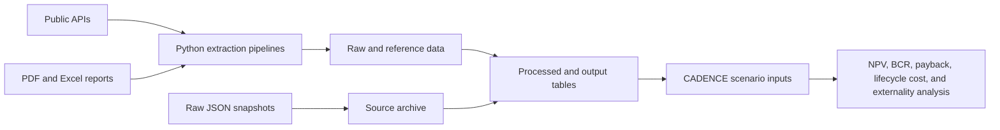

# Economic Externalities Research Database

## Enhanced Repository Guide

**Repository audit date:** 2026-07-31

This repository is the research-data layer for CADENCE economic and externality analysis. It collects public finance, energy, failure-cost, community, carbon, insurance, and incentive data; converts the sources into analysis-ready tables; and documents how those tables can support net present value (NPV), benefit-cost ratio (BCR), payback, lifecycle cost, and scenario analysis.

The repository is not yet a single packaged application. It is a collection of standalone extraction and transformation pipelines, committed source snapshots, generated datasets, and planning documents. Each pipeline can be refreshed independently. The final CADENCE calculation engine that combines all benefit and cost streams is outside the implemented scope of this repository.

## Review Scope

This guide was prepared from a code and artifact review of:

- 18 Python files.
- 11 Markdown research and methodology files.
- 17 generated CSV datasets plus one Parquet mirror.
- Local PDF and Excel source documents.
- Rewiring America raw JSON response captures.
- The current schemas, row counts, CLI options, API-key requirements, and output paths.

Current implementation status:

- 13 implemented pipelines.
- 1 partially implemented pipeline: ACS property values currently exports county data but skips failed tract requests.
- 2 empty task files.
- 1 notes-only DSIRE file.
- Several planned modules documented without executable calculations yet.

## What Has Been Done

| Domain | Pipeline | Status | Main result |
|---|---|---:|---|
| Finance | `Finance/inflation/Task_1_Inflation.py` | Implemented | FRED inflation indices and CBO long-term rates |
| Finance | `Finance/discount/Task_2_Discount_Rates.py` | Empty | Discount-rate CSVs exist, but this task does not generate them |
| Finance | `Finance/financing/Task_3_Mortgage_Rates.py` | Implemented | FRED 15-year and 30-year mortgage-rate history |
| Finance | `Finance/financing/Task_4_Cost_of_Capitial.py` | Implemented | Damodaran global industry WACC table |
| Energy | `Energy/thermal/Task_5_Cool_Roofs.py` | Implemented | Raw CRRC products and grouped optical-property statistics |
| Failure costs | `Failure Costs/disposal/Task_7_Disposal.py` | Implemented | EREF 2024 state and regional tipping fees |
| Failure costs | `Failure Costs/disposal/Task_8_weight_converstion.py` | Empty | Roofing weight and waste conversion is not implemented |
| Failure costs | `Failure Costs/housing/temporary_housing_relocation_costs.py` | Implemented | HUD Fair Market Rent monthly and daily relocation-cost proxies |
| Community | `Community/GDP/Task_9_GDP.py` and `bea_county_gdp.py` | Implemented | County-year GDP, population, growth, and sector shares |
| Community | `Community/property values/Task_10_Property_values.py` | Partial | Five-year ACS history; current output is county-only |
| Community | `Community/employment/Task_14_employment_metrics.py` | Implemented | BLS QCEW residential construction and roofing employment anchors |
| Carbon | `Carbon/SCC/Task_11_SCGHG.py` | Implemented | EPA social cost of CO2, CH4, and N2O for 2020-2080 |
| Carbon | `Carbon/SCC/Task_12_SCGHG_NY.py` | Implemented | NY DEC social cost values for 12 gases for 2020-2050 |
| Carbon | `Carbon/emissions_disposal/Task_13_EPA_WARM_EF.py` | Implemented | Roofing end-of-life emission factors using EPA/WARM proxies |
| Insurance | `Insurance/premiums/extraction_premiums.py` | Implemented with portability issue | NAIC 2022 premium benchmarks by state, policy form, and insured-value range |
| Incentives | `Incentives/federal/rewiring_america.py` | Implemented sample | Programs and raw API responses for three sample ZIP codes |
| Incentives | `Incentives/federal/DSIRE.py` | Notes only | Future subscription-based DSIRE integration |

## Repository Data Flow



The repository uses three broad artifact layers:

- `data/raw/`: source-like API captures and minimally transformed product records.
- `data/processed/`, domain `reference/` folders, and domain-local CSVs: normalized analytical datasets.
- `Outputs/`: cross-domain final lookup tables intended for direct downstream use.

Some older scripts write outputs inside their domain folder instead of these layers. Paths are therefore documented per pipeline rather than inferred from folder name alone.

## Quick Start

Run commands from the repository root so relative source and output paths resolve consistently.

### 1. Create and activate an environment

```bash
python3 -m venv .venv
source .venv/bin/activate
```

### 2. Install dependencies

The repository does not currently include a `requirements.txt` or `pyproject.toml`. Install the packages used across all pipelines:

```bash
python -m pip install pandas requests numpy python-dotenv pdfplumber openpyxl xlrd pyarrow tabulate
```

Core API pipelines use `pandas`, `requests`, `numpy`, and `python-dotenv`. PDF extraction uses `pdfplumber`; Excel extraction uses `openpyxl` and may need `xlrd` for legacy `.xls` files; NY Parquet export requires `pyarrow`; `tabulate` is optional for the EPA/WARM console preview.

### 3. Configure API keys

Create a local `.env` file in the repository root. Do not commit secrets.

```dotenv
FRED_API_KEY=
BEA_API_KEY=
CENSUS_API_KEY=
HUD_API_KEY=
REWIRING_AMERICA_API_KEY=
```

| Variable | Used by | Requirement |
|---|---|---|
| `FRED_API_KEY` | Inflation and mortgage pipelines | Required for FRED calls |
| `BEA_API_KEY` | County GDP pipeline | Required |
| `CENSUS_API_KEY` | ACS property-value pipeline | Optional in code, recommended for rate limits |
| `HUD_API_KEY` | Temporary housing pipeline | Required |
| `REWIRING_AMERICA_API_KEY` | Incentive sample | Required |

BLS QCEW, CRRC, CBO, and Damodaran sources do not require API keys in the current implementation.

## Running the Pipelines

### Finance

```bash
python Finance/inflation/Task_1_Inflation.py
python Finance/financing/Task_3_Mortgage_Rates.py
python Finance/financing/Task_4_Cost_of_Capitial.py
```

Important behavior:

- Inflation downloads FRED series `CPIAUCSL`, `CPILFESL`, and `PCEPI`, plus a CBO February 2026 long-term rate file.
- Inflation and WACC first try absolute `/data/economics/...` paths and fall back to repository-local `data/economics/...` only when that write fails.
- Mortgage rates always write to the repository-local `data/economics/mortgage_rates/` folder.
- The CBO URL and the WACC output filename contain a 2026 vintage and must be reviewed during annual refreshes.
- `Task_2_Discount_Rates.py` is empty. The existing OMB and Treasury CSVs cannot currently be regenerated by repository code.

### Energy

```bash
python Energy/thermal/Task_5_Cool_Roofs.py
```

The script downloads the CRRC daily roof-directory CSV, keeps valid product IDs, converts performance fields to numeric values, and groups products by type and color. The planned Energy Delta Module in `Energy/thermal/energy_module_planning.md` has not yet implemented the conversion from optical properties to annual kWh or dollar savings.

### Failure Costs

```bash
python "Failure Costs/disposal/Task_7_Disposal.py"
python "Failure Costs/housing/temporary_housing_relocation_costs.py" \
  --year 2025 \
  --days-per-month 30 \
  --primary-bedroom Two-Bedroom
```

The disposal parser requires the local EREF PDF with its current filename. The housing pipeline queries every HUD state or territory returned by `listStates`, retries failed requests up to three times, and converts monthly FMR values to daily values. HUD can return multiple rows for one county FIPS because metro, town, and small-area geographies are retained.

### Community

```bash
python Community/GDP/Task_9_GDP.py --years LAST10
python Community/GDP/Task_9_GDP.py --years ALL --refresh-schema
python "Community/property values/Task_10_Property_values.py" \
  --target-year 2024 \
  --years-back 5
python Community/employment/Task_14_employment_metrics.py \
  --year 2025 \
  --quarter 3
```

The GDP wrapper passes CLI arguments to the full BEA pipeline. Supported year selectors include `ALL`, `LAST5`, `LAST10`, `LASTN`, and explicit comma-separated years. BEA line codes are discovered dynamically and cached in `Community/GDP/reference/bea_line_codes.json`.

The ACS pipeline is designed for county and tract output, but the current `tract:*` wildcard request fails and is skipped by year. The checked-in output contains county rows only. The FHFA supplemental merge is also a stub.

The BLS pipeline retrieves one year-quarter at a time for NAICS `2361`, `23816`, `238161`, `238162`, and `238163`. Missing or unpublished slices are skipped, so successful output does not guarantee that every requested industry was available.

### Carbon

```bash
python Carbon/SCC/Task_11_SCGHG.py
python Carbon/SCC/Task_12_SCGHG_NY.py --output-dir Outputs
python Carbon/emissions_disposal/Task_13_EPA_WARM_EF.py --output-dir Outputs
```

All three carbon pipelines use local source documents already stored in the repository. The EPA and NY scripts validate expected years and row counts. The NY script fails the run if it cannot write Parquet; install `pyarrow` before running it. The roofing end-of-life table maps 14 roof materials to the closest available EPA GHG Hub/WARM material and retains mapping notes because several materials do not have exact source matches.

### Insurance

```bash
python Insurance/premiums/extraction_premiums.py
```

The checked-in output is usable, but the extraction command is not portable in its current form. The script contains absolute paths tied to the original workstation, and its referenced NAIC PDF is not present in this checkout. The two 2018-2022 homeowners-market Excel workbooks in `Insurance/premiums/data/` are reference files but are not consumed by this extractor.

The deductible, discount, and premium Markdown files describe future modeling assumptions. No property-level premium prediction, deductible database, or insurer discount pipeline has been implemented.

### Incentives

```bash
python Incentives/federal/rewiring_america.py
```

The script is a research sampler, not a nationwide production pull. It uses hard-coded ZIP codes `20001`, `30301`, and `94102`, queries utility IDs, runs language and authority-filter scenarios, writes one flattened CSV, and archives each raw response. It has a 60-second request timeout but no retry or rate-limit handling. DSIRE remains notes-only.

## Current Data Catalog

Row counts below describe the checked-in files as audited on 2026-07-31. They will change when pipelines are refreshed.

### Finance

| Dataset | Rows | Main fields | Intended use |
|---|---:|---|---|
| `data/economics/inflation/fred_inflation.csv` | 2,595 | `date`, `series_id`, `value` | Build historical escalation factors using headline CPI, core CPI, or PCE |
| `data/economics/inflation/cbo_longterm_raw.csv` | 1,464 | `date`, `variable`, `value` | Long-horizon macroeconomic assumptions and sensitivity cases |
| `data/economics/mortgage_rates/fred_mortgage_rates.csv` | 4,703 | `date`, `loan_type`, `interest_rate` | Homeowner debt-cost and financing scenarios |
| `data/economics/cost_of_capital/damodaran_wacc_2026.csv` | 96 | `industry`, `num_firms`, `beta`, `cost_of_equity`, `cost_of_debt`, `wacc` | Private-sector hurdle rates and WACC sensitivity inputs |
| `data/economics/discount_rates/omb_a94_2026.csv` | 6 | `maturity_years`, `nominal_rate`, `real_rate`, `budget_year` | Federal-style nominal and real discount assumptions; no current generator |
| `data/economics/discount_rates/treasury_avg_rates.csv` | 1,001 | date, security descriptors, average rate, calendar and fiscal fields | Low-risk market discount anchors; no current generator |

Use real discount rates with constant-dollar cash flows and nominal rates with nominal-dollar cash flows. Do not combine inflation-escalated cash flows with a real rate without an explicit conversion.

### Energy

| Dataset | Rows | Main fields | Intended use |
|---|---:|---|---|
| `data/raw/cool_roofs_raw.csv` | 3,193 | manufacturer, product, type, color, initial and three-year reflectance/emittance/SRI, CRRC ID | Product-level screening, traceability, and degradation comparisons |
| `data/processed/cool_roofs_summary.csv` | 247 | product type, color, count, mean/median/std/min/max for six performance metrics | Baseline values and uncertainty ranges for roof-energy scenarios |

Three-year performance values are the preferred stabilized-field proxy in the planned Energy Delta Module. The repository does not yet calculate roof temperature, HVAC load, kWh savings, heating penalties, or utility savings.

### Failure Costs

| Dataset | Rows | Main fields | Intended use |
|---|---:|---|---|
| `Failure Costs/disposal/EREF_2024_Tipping_Fees_Parsed.csv` | 51 | region/state, average tipping fee, standard deviation | Regional landfill unit-cost assumptions and uncertainty ranges |
| `Failure Costs/housing/temporary_housing_relocation_costs.csv` | 4,764 | year, state/county/HUD geography, five bedroom-tier monthly and daily values, selected daily cost | Estimate temporary relocation expense during loss-of-use periods |

The disposal pipeline currently provides dollars per ton, but the roof-area-to-waste-mass bridge is missing because Task 8 is empty. A complete disposal cost calculation will require sourced pounds-per-square or pounds-per-square-foot factors by roofing material.

### Community

| Dataset | Rows | Main fields | Intended use |
|---|---:|---|---|
| `Community/GDP/reference/county_gdp.csv` | 41,171 | county FIPS, year, nominal/real GDP, growth, population, GDP per capita, sector shares | Scale and contextualize local economic exposure and recovery effects |
| `Community/GDP/reference/bea_line_codes.json` | Cached schema | BEA parameters and line-code descriptions | Reproducible mapping from BEA source tables to normalized fields |
| `Community/GDP/reference/county_gdp_data_quality_notes.md` | Audit report | share checks, suppression count, geography notes, row counts | Required companion QA documentation for GDP use |
| `data/processed/cadence_property_values_acs5.csv` | 16,108 | year, geography, FIPS, median value, housing units, owner occupancy | Property-value exposure and owner-occupancy context at county level |
| `Outputs/bls_qcew_housing_roofing_anchors.csv` | 8,721 | area FIPS, ownership, industry, quarter, establishments, employment, wages | Local contractor capacity, workforce, and payroll anchors |

County FIPS is the main cross-domain join key. Treat it as a zero-padded string, not an integer. GDP data also requires a year key; BLS requires year and quarter; ACS requires year and geography level.

### Carbon

| Dataset | Rows | Main fields | Intended use |
|---|---:|---|---|
| `Carbon/SCC/table_a5_1_scghg_unrounded_2020_2080.csv` | 61 | emission year and gas-specific values at 2.5%, 2.0%, and 1.5% | Federal social-cost monetization for CO2, CH4, and N2O |
| `Outputs/scghg_ny_combined.csv` | 1,116 | gas, year, discount rate, value, unit, source table/document | New York-specific social-cost scenarios across 12 gases |
| `Outputs/scghg_ny_combined.parquet` | 1,116 logical rows | Same schema as the NY CSV | Typed and compressed analytics input |
| `Outputs/roofing_eol_emission_factors.csv` | 14 | roof material, WARM proxy, landfill/recycling factors in two unit systems, notes | Convert roofing waste mass and pathway into lifecycle CO2e |

Select a social-cost table deliberately. EPA and NY values have different policy provenance, gas coverage, year ranges, and scenario framing and should not be silently mixed within one analysis.

### Insurance

| Dataset | Rows | Main fields | Intended use |
|---|---:|---|---|
| `Insurance/premiums/data/naic_2022_avg_premium_clean.csv` | 8,320 | state, policy form, insured-value range, exposure house-years, premium, average premium, table, year | State-level baseline premium lookup by coverage form and value band |

This is a benchmark, not a property-level quote model. `exposure_house_years` is the credibility/weighting field, and `avg_premium_dollars` is the normalized premium measure. Deductible choices, roof attributes, hazard exposure, carrier discounts, and claims history are not modeled in the current dataset.

### Incentives

| Dataset | Rows | Main fields | Intended use |
|---|---:|---|---|
| `data/raw/rewiring/incentives_programs_deep_dive_sample.csv` | 41 | ZIP, scenario/filter metadata, program and authority fields, status/error fields, raw file | Evaluate API coverage and support user-directed local incentive research |
| `data/raw/rewiring/api_*.json` | 6 snapshots | Observed endpoint-specific response structures | API schema reference and research provenance |
| `data/raw/rewiring/incentives_programs_deep_dive_raw/*.json` | 27 captures | Utility lookups and scenario responses for three ZIP codes | Auditable source responses behind the flattened sample |

The snapshots cover calculator, utilities, incentive programs, finance loans, health impacts, and residential electrification model endpoints. Only the incentive-program endpoint is transformed by the current Python sampler.

## Local Source and Reference Files

The following source documents support reproducible extraction:

| Source file | Used by or role |
|---|---|
| `Carbon/SCC/Epa_scghg_2023_report_final.pdf` | EPA Table A.5.1 extraction |
| `Carbon/SCC/New_York_SCGHG.pdf` | NY DEC Tables A1-A12 extraction |
| `Carbon/emissions_disposal/ghg-emission-factors-hub-2025.xlsx` | EPA GHG Hub Table 9 roofing proxy extraction |
| `Failure Costs/disposal/2025-EREF-Report-MSWLF-Tipping-Fees-2024-FINAL-xtdyli.pdf` | EREF Table A2 extraction |
| `Failure Costs/disposal/EREF-2021-LandfillTipFeeList.xlsx` | Older disposal reference; not consumed by Task 7 |
| `Insurance/premiums/data/US_Homeowners_Insurance_Markets_2018-2022.xlsx` | Insurance-market reference; not consumed by the PDF extractor |
| `Insurance/premiums/data/Supporting_Underlying_Metrics_and_Disclaimer_for_Analyses_of_US_Homeowners_Insurance_Markets_2018-2022.xlsx` | Supporting insurance reference; not consumed by the PDF extractor |

Keep source vintage and output vintage together. Replacing a PDF or workbook with a newer edition may require page, table, header-row, label, or proxy-map changes before rerunning its parser.

## How the Data Will Be Used

### 1. Define the scenario and geography

Use a five-digit county FIPS as the common key for GDP, ACS, BLS, and HUD-based data. Preserve leading zeroes. Record the analysis year, project life, roof type, roof area, financing structure, disposal pathway, displacement duration, and policy geography.

### 2. Establish financial assumptions

- Use FRED or CBO data to convert costs to a common dollar year and define escalation.
- Use mortgage history for household debt scenarios.
- Use Damodaran WACC for private-sector hurdle-rate cases.
- Use OMB or Treasury snapshots for public/social or low-risk discount-rate sensitivity cases.

### 3. Estimate direct and avoided costs

- Disposal: combine roof waste mass with the EREF tipping fee for the selected region.
- Temporary housing: multiply modeled displacement days by `relocation_cost_per_day` for the selected HUD geography and bedroom tier.
- Insurance: map property value and policy form to the closest NAIC insured-value range as a baseline only.
- Incentives: inspect location-matched programs and subtract confirmed eligible incentives from project cost.

Conceptually:

$$
\text{Relocation cost} = \text{days displaced} \times \text{daily FMR proxy}
$$

$$
\text{Disposal cost} = \text{waste mass in tons} \times \text{tipping fee per ton}
$$

The second calculation cannot yet be completed solely from this repository because material weight conversion is not implemented.

### 4. Estimate energy and carbon effects

- Select initial or three-year CRRC reflectance and emittance values for the existing and replacement roof.
- Pass those values to a calibrated energy model once the Energy Delta Module is implemented.
- Multiply roofing waste mass by the selected landfill or recycling emission factor.
- Monetize emissions with a matching gas, year, discount-rate scenario, and policy source.

Conceptually:

$$
\text{End-of-life emissions} = \text{material mass} \times \text{pathway emission factor}
$$

$$
\text{Monetized carbon effect} = \text{emissions by gas} \times \text{social cost by gas and year}
$$

### 5. Add community context

- GDP and sector shares describe the scale and composition of the county economy.
- ACS property values and housing counts describe exposed assets and owner occupancy.
- BLS establishments, employment, and wages provide local implementation-capacity and labor-market anchors.

These are context and scaling variables. They should not be interpreted as causal estimates of project impacts without an explicit economic model.

### 6. Build annual cash flows

After all inputs are converted to consistent units and dollar years, assemble annual project costs and benefits. A downstream engine can then calculate:

$$
NPV = \sum_{t=0}^{T} \frac{B_t - C_t}{(1+r)^t}
$$

$$
BCR = \frac{\sum_{t=0}^{T} B_t/(1+r)^t}{\sum_{t=0}^{T} C_t/(1+r)^t}
$$

where $B_t$ is total benefit in year $t$, $C_t$ is total cost in year $t$, $r$ is the selected discount rate, and $T$ is the analysis horizon. These calculations are intended uses; they are not implemented by the scripts in this repository.

## Data Quality and Validation

Implemented checks include:

- EPA SC-GHG validates exactly 61 contiguous years from 2020 through 2080.
- NY SC-GHG validates 12 gases, 31 years, 3 discount rates, and 1,116 rows.
- GDP writes a companion quality report, tracks suppressed BEA cells, and reports share anomalies.
- Insurance checks for 8,320 expected rows and spot-checks the Countrywide HO-3 total average premium.
- EREF extraction stops at the next table and deduplicates region names.
- EPA/WARM extraction warns when annual workbook labels no longer match a configured proxy.
- BLS filters to five-digit county-style FIPS values and reports unavailable slices.

The repository has no automated test suite, CI workflow, schema contracts, or central validation command. Generated row counts should therefore be treated as useful checks, not sufficient proof that a refreshed source retained the same meaning.

## Known Limitations

1. **No orchestrator or package definition.** Pipelines are run independently, and dependencies are not pinned.
2. **Discount-rate lineage is incomplete.** OMB and Treasury CSVs are present, but Task 2 is empty.
3. **Roofing waste conversion is missing.** Task 8 is empty, blocking an end-to-end roof-area-to-disposal-cost calculation.
4. **The energy savings model is planned only.** CRRC inputs exist, but kWh, utility savings, heating penalties, and lifetime degradation are not calculated.
5. **ACS tract coverage is not working.** Tract requests fail and are skipped; the current output is county-only.
6. **GDP sector shares require care.** The current quality report finds 20,955 county-year rows where the four selected shares sum to more than 1.0. Connecticut's transition to planning regions also affects comparability over time.
7. **Insurance extraction is not reproducible on another machine as written.** It uses absolute paths and references a PDF that is not present in the repository.
8. **Insurance remains a broad benchmark.** Property-specific premiums, deductibles, discounts, and resilience credits are future work.
9. **EPA/WARM roofing factors use proxies.** Several roofing materials lack exact EPA categories; the `Notes` column must travel with the numeric factors.
10. **Rewiring America coverage is a sample.** ZIPs and scenario filters are hard-coded, and requests have no retry logic.
11. **Source formats may drift.** Several PDF pages, Excel header rows, annual URLs, filenames, and source labels are hard-coded.
12. **Output paths are inconsistent.** Two finance scripts prefer absolute `/data` paths, while most other scripts write under the repository.

## Refresh Guidance

| Data area | Suggested trigger | Review before running |
|---|---|---|
| FRED inflation and mortgage rates | Monthly, quarterly, or before an analysis release | API key and date coverage |
| CBO long-term assumptions | New CBO long-term release | Hard-coded source URL and variable definitions |
| Damodaran WACC | Annual January update | Workbook format and output vintage name |
| OMB and Treasury rates | New budget guidance or analysis baseline | Add a reproducible Task 2 implementation |
| CRRC cool roofs | Before a product/performance release | Daily export schema and collection date |
| EREF tipping fees | New EREF report | PDF filename, table marker, units, and coverage |
| HUD FMR | Annual FMR release | Requested year, bedroom tier, and geography duplication |
| BEA county GDP | Annual release or scenario update | Cached line codes, CT geography, and quality report |
| ACS property values | Annual ACS 5-year release | Tract-query fix and Census variable continuity |
| BLS QCEW | Quarterly after publication lag | Requested quarter and missing industry slices |
| EPA/NY social cost values | New policy guidance | Dollar year, gas coverage, page/table mapping, and discount rates |
| EPA GHG Hub factors | New annual Hub workbook | Table position, labels, and roofing proxy map |
| NAIC premiums | New report or data-call release | Source portability and policy/table definitions |
| Rewiring America | Before local incentive analysis | API schema, rate limits, ZIP scope, and program eligibility dates |

## Planned Work Identified in the Repository

Priority gaps that directly unlock downstream analysis:

1. Implement Task 8 roofing weight conversions with source citations and unit tests.
2. Implement Task 2 so OMB and Treasury discount-rate files are reproducible.
3. Repair ACS tract retrieval by issuing supported state-by-state county/tract requests.
4. Make the insurance extractor accept relative CLI input/output paths and retain its source PDF.
5. Calibrate and implement the Energy Delta Module described in `Energy/thermal/energy_module_planning.md`.
6. Add a dependency file, schema validation, and focused tests for parsers and unit conversions.
7. Parameterize Rewiring America ZIPs and add retry, backoff, and explicit refresh metadata.
8. Continue disposal research with recycler locations, recycling fees, material acceptance, and hauling assumptions.
9. Develop property-level insurance, deductible, discount, and resilience-credit methods only after defensible source data are available.

## Interpretation Standard

Every downstream use should retain:

- Source organization and document/API name.
- Data vintage and collection date.
- Geography and join key.
- Unit and dollar year.
- Nominal versus real treatment.
- Discount-rate source and value.
- Proxy or fallback assumptions.
- Missing-data and geographic-coverage flags.

The repository is strongest when used as a transparent, refreshable input library. It should not be treated as a set of universal default values without scenario-specific choices and the caveats documented above.